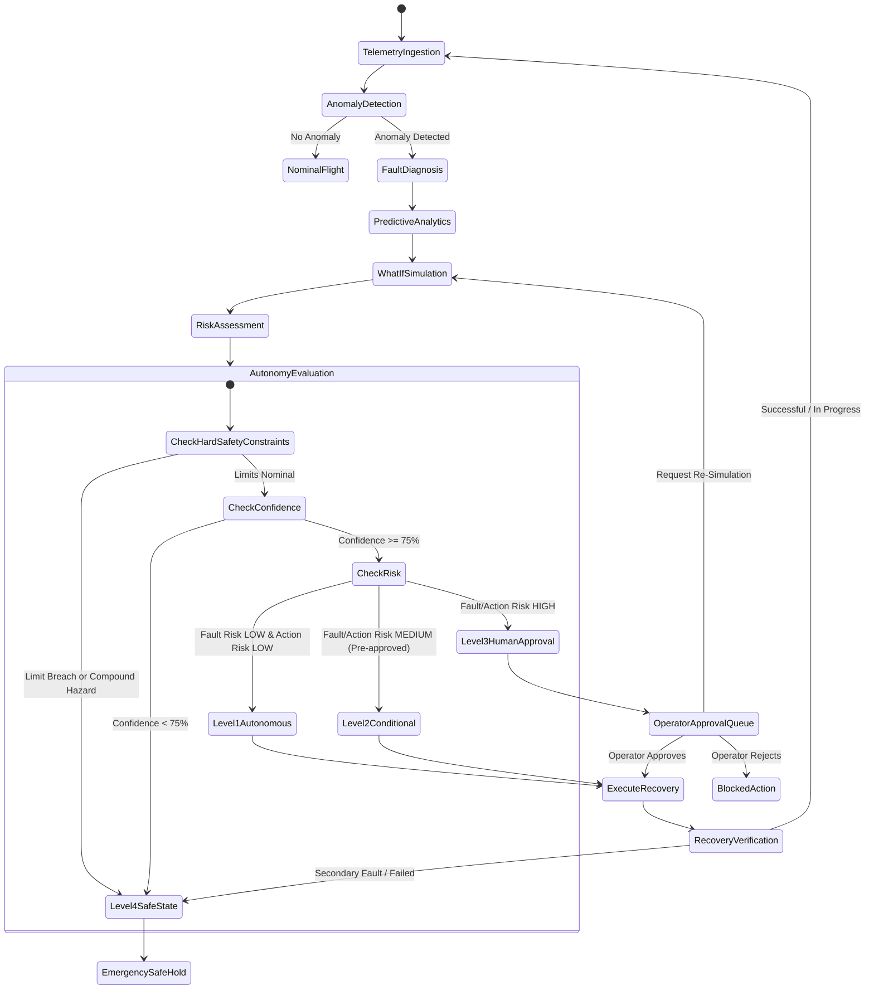

# System Architecture Documentation
## AI-SHMC: AI-Based Self-Healing Mission Control Copilot for Autonomous Spacecraft Operations

---

## 1. Executive Architecture Summary

**AI-SHMC** is an intelligent, fault-tolerant ground control and autonomous spacecraft copilot prototype designed to handle multi-subsystem telemetry monitoring, failure diagnosis, trajectory prediction, pre-execution what-if simulation, independent risk classification, safety-gated autonomy, human-in-the-loop sign-off, and empirical post-recovery verification.

The application follows an eight-stage closed-loop operational pipeline:

```
DETECT ──> DIAGNOSE ──> PREDICT ──> SIMULATE ──> ASSESS RISK ──> DECIDE ──> RECOVER ──> VERIFY
```

---

## 2. High-Level Architectural Diagram

```
+---------------------------------------------------------------------------------------------------+
|                                  SPACECRAFT DIGITAL TWIN SIMULATION                              |
|  +--------------------+  +--------------------+  +--------------------+  +--------------------+   |
|  |  Power Subsystem   |  | Thermal Subsystem  |  |   Comm Subsystem   |  | Processing Subsys  |   |
|  | (V, I, SoC, Solar) |  | (T_bat, T_cpu, TEC)|  | (RSSI, Loss, Lat)  |  | (CPU%, Mem%, Lat)  |   |
|  +--------------------+  +--------------------+  +--------------------+  +--------------------+   |
|  +--------------------+  +--------------------+  +--------------------+                           |
|  |  Storage Subsystem |  | Payload Subsystem  |  | 10 Fault Scenarios |                           |
|  | (Usage, R/W, Integ)|  | (Activity, Pwr, S) |  | Injector Engine    |                           |
|  +--------------------+  +--------------------+  +--------------------+                           |
+---------------------------------------------------------------------------------------------------+
                                                  │
                                                  ▼ Telemetry Stream (1 Hz)
+---------------------------------------------------------------------------------------------------+
|                                        AI / ML INTELLIGENCE PIPELINE                              |
|  +-------------------------------------+  +---------------------------------------------------+   |
|  | Anomaly Detection (Isolation Forest)|  | Fault Diagnosis (Multiclass Random Forest)        |   |
|  | - Quantitative deviation attribution|  | - Calibrated class probability & confidence       |   |
|  +-------------------------------------+  +---------------------------------------------------+   |
|  +-------------------------------------+  +---------------------------------------------------+   |
|  | Predictive Analytics (RF Regressors)|  | Digital Twin What-If Sandbox (Cloned States)      |   |
|  | - 1m, 3m, 5m, 10m horizon forecast  |  | - Forward candidate recovery evaluation           |   |
|  +-------------------------------------+  +---------------------------------------------------+   |
+---------------------------------------------------------------------------------------------------+
                                                  │
                                                  ▼ Candidate Actions & Hypotheses
+---------------------------------------------------------------------------------------------------+
|                                    SAFETY & AUTONOMY GATEWAY                                      |
|  +-------------------------------------+  +---------------------------------------------------+   |
|  | FMEA Fault Risk Engine (S x P: 1-25)|  | Recovery Action Risk Evaluator (Reversibility)    |   |
|  +-------------------------------------+  +---------------------------------------------------+   |
|  +--------------------------------------------------------------------------------------------+   |
|  | Safety & Autonomy Manager (Deterministic Priority Gateway)                                 |   |
|  | - Level 1: Low Risk (Full Autonomous Recovery)                                             |   |
|  | - Level 2: Medium Risk (Conditional Autonomy with DT Checks)                               |   |
|  | - Level 3: High Risk (Human Operator Approval Required)                                    |   |
|  | - Level 4: Critical / Uncertain (Unsafe Recovery Blocked; Safe-State Escalation)           |   |
|  +--------------------------------------------------------------------------------------------+   |
+---------------------------------------------------------------------------------------------------+
             │                                                           │
             ▼ Autonomous Execution (Level 1 / 2)                        ▼ Human Gate (Level 3)
+-----------------------------------------+                 +---------------------------------------+
|        AUTONOMOUS RECOVERY ENGINE       |                 |     HUMAN-IN-THE-LOOP APPROVAL        |
| - Bounded command dispatch              |                 | - Operator review dossier             |
| - Max retry protection                  |                 | - APPROVE / REJECT / RE-SIMULATE      |
| - Reversible rollback snapshot          |                 +---------------------------------------+
+-----------------------------------------+                                     │ Approved Action
             │                                                                  │
             └──────────────────────────────────┬───────────────────────────────┘
                                                ▼
+---------------------------------------------------------------------------------------------------+
|                                  RECOVERY VERIFICATION ENGINE                                     |
| - Collect settled post-action telemetry                                                           |
| - Calculate delta parameter improvement & health gain                                             |
| - Verify secondary hazard absence                                                                 |
| - Verdicts: RECOVERY_SUCCESSFUL | IN_PROGRESS | FAILED | SECONDARY_FAULT | ESCALATION_REQUIRED     |
+---------------------------------------------------------------------------------------------------+
                                                │
                                                ▼ Flight Audit Logging
+---------------------------------------------------------------------------------------------------+
|                        FASTAPI REST BACKEND & SQLITE PERSISTENCE LAYER                            |
| - 9 Persistent Tables: Telemetry, Anomalies, Diagnoses, Predictions, Risks, Recoveries, Approvals |
| - Modern Plotly + Streamlit Dark Mission Control UI (10 Interactive Pages)                        |
+---------------------------------------------------------------------------------------------------+
```

---

## 3. Subsystem Mathematical & Operational Specifications

### 3.1 Power Subsystem
- **Battery Terminal Voltage ($V_{bat}$):**
  $$V_{nom} = 24.0 + \left(\frac{SoC}{100}\right) \times 6.5$$
  Under discharge: $V_{bat} = V_{nom} - (I_{dis} \times R_{int})$.
  Under charge: $V_{bat} = V_{nom} + (I_{chg} \times R_{int})$.
- **Solar Array Generation ($P_{solar}$):**
  $$P_{solar} = V_{solar} \times I_{solar} \times \cos(\theta_{offset}) \times \eta_{solar}$$
  where $\theta_{offset}$ is panel Sun-pointing error and $\eta_{solar}$ is surface degradation factor.
- **State of Charge ($SoC$):**
  $$\frac{d(SoC)}{dt} = \frac{P_{solar} - P_{consumption}}{C_{total}} \times 100$$

### 3.2 Thermal Subsystem
- **Battery Thermal Balance:**
  $$\frac{dT_{bat}}{dt} = \frac{I_{bat}^2 R_{int} - k_{rad} (T_{bat} - T_{sink})}{C_{th,bat}}$$
- **CPU Thermal Balance:**
  $$\frac{dT_{cpu}}{dt} = \frac{P_{cpu} - k_{cool}(T_{cpu} - T_{int})}{C_{th,cpu}}$$

### 3.3 Communication Subsystem
- **Link Carrier & Packet Loss:**
  $$RSSI = RSSI_0 - (\theta_{track} \times 8.5) - (\alpha_{RF} \times 35.0)$$
  When $RSSI < -110\text{ dBm}$, packet loss surges exponentially.

---

## 4. Safety & Autonomy State Machine



---

## 5. API Endpoints Catalog

| Method | Route | Description |
|---|---|---|
| `GET` | `/api/telemetry/current` | Real-time telemetry readings across all 6 subsystems |
| `POST` | `/api/simulation/step` | Advances simulation physics by $dt$ seconds |
| `POST` | `/api/simulation/pause` | Pauses simulation clock |
| `POST` | `/api/simulation/resume` | Resumes simulation clock |
| `POST` | `/api/simulation/reset` | Resets spacecraft twin to nominal baseline |
| `POST` | `/api/simulation/speed` | Sets simulation time acceleration (1x, 2x, 5x, 10x) |
| `GET` | `/api/simulation/scenarios` | Lists all 10 supported fault injection scenarios |
| `POST` | `/api/simulation/inject_fault` | Injects designated fault scenario by ID |
| `POST` | `/api/simulation/clear_faults` | Clears active faults, restoring nominal conditions |
| `GET` | `/api/ai/anomaly` | Evaluates Isolation Forest and statistical bounds |
| `GET` | `/api/ai/diagnose` | Evaluates Multiclass Random Forest fault classification |
| `GET` | `/api/ai/predict` | Multi-horizon regression forecasting (1m, 3m, 5m, 10m) |
| `POST` | `/api/digital_twin/what_if` | Clones state and runs forward candidate evaluations |
| `GET` | `/api/safety/autonomy_decision` | Deterministic 8-step safety gate autonomy classification |
| `GET` | `/api/approval/pending` | Lists pending operator sign-off requests |
| `POST` | `/api/approval/{id}/decide` | Submits operator decision (APPROVE / REJECT / RE-SIMULATE)|
| `POST` | `/api/recovery/execute` | Dispatches authorized recovery command to twin |
| `POST` | `/api/copilot/cycle` | Executes full end-to-end 8-stage copilot cycle |
| `GET` | `/api/events/history` | Retrieves auditable mission flight logs with filters |
| `GET` | `/api/metrics/summary` | Holdout validation benchmark metrics (F1, MAE, RMSE) |

